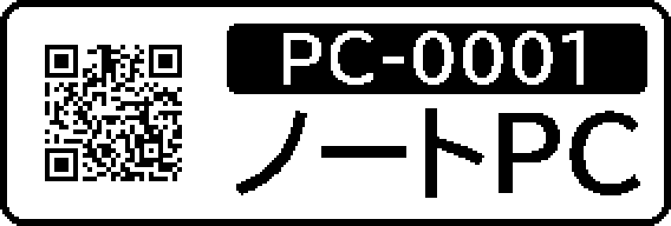

# Nelko P21 Label Printer (desktop)

Print labels on a **Nelko P21** from a Windows or Mac computer instead of the phone app.
The app works entirely offline: it only talks to the printer over Bluetooth.

A fork of [p21studio](https://github.com/mocchan0221/p21studio) (MIT) by mocchan0221, which does the
printer protocol. This fork adds a minimal desktop app, italic/underline text, and English messages.

## Desktop app

- **Print page**: type text; bold, italic, underline, font, size; live preview; quantity; print now or add to a queue.
- **History page**: the last 50 printed labels. Click one to load it, or reprint it. Searchable.
- Light, dark or system theme. Labels: 14 × 40 mm.

| Shortcut | Action |
|---|---|
| Ctrl+Enter | Print now |
| Ctrl+Shift+Enter | Add to queue |
| Ctrl+P | Print queue |
| Ctrl+B / I / U | Bold / italic / underline |
| Ctrl+Z | Undo removing a queue item |
| Ctrl+1 / Ctrl+2 | Print page / History page |
| Ctrl+F | Search history |

### Set up (once)

```bash
python -m venv .venv
.venv/Scripts/pip install -e .        # macOS: .venv/bin/pip install -e .
```

### Run

```bash
.venv/Scripts/p21-desktop
```

Turn the printer on and close the Nelko phone app first: the P21 accepts one connection at a time.
The app finds the printer over Bluetooth LE without pairing. If it doesn't, pair "P21" in the
system Bluetooth settings and click the Bluetooth icon in the app.

To try the app without using labels, run it with `P21_DEVICE=mock:`. Each "printed" label is
saved as a PNG instead.

### Privacy

The desktop app makes no internet connections. It uses Bluetooth only, and its only dependencies are
Pillow and bleak (plus the bundled [Lucide](https://lucide.dev) icon font, ISC licence). History and settings
are saved in your user folder (`%APPDATA%\p21studio` on Windows, `~/Library/Application Support/p21studio`
on macOS). This fork removed the original project's browser GUI and MCP server (they opened local network ports) for privacy.

---

## Original project documentation

### P21 Studio

Nelko P21（Bluetooth ラベルプリンタ）を **スマホアプリなしで PC から使う**ためのツールです。

- **CLI**: `p21 print -t "ラベル"` のようにコマンド 1 行で印刷。全コマンドに `--json` があります
- **AI 連携**: JSON のラベル形式、プレビュー PNG 出力（このフォークでは GUI / MCP は削除済み）
- Windows / macOS / Linux（Raspberry Pi も可）。Python 3.10 以上

プロトコルの調査結果は [research/](research/README.md) にまとめてあります。



## インストール

```bash
# どれか 1 つ
uv tool install .            # おすすめ（uv: https://docs.astral.sh/uv/）
pipx install .
pip install .
```

開発用: `uv venv && uv pip install -e ".[dev]"` → `.venv` の `p21` を使います。

## 最初の設定（プリンタをつなぐ）

1. P21 の電源を入れ、**OS の Bluetooth 設定で「P21」をペアリング**します。
2. `p21 scan` で探し、表示されたものを既定にします。

```bash
p21 scan
p21 use rfcomm:AA:BB:CC:DD:EE:FF   # scan が出したものをそのまま
p21 info                            # 状態・入っているラベルのサイズ・電池
```

| OS | おすすめの指定 | 補足 |
|---|---|---|
| Windows | `rfcomm:<MAC>` | COM ポートでも可: `serial:COM5`（「送信」側のポート） |
| Linux | `rfcomm:<MAC>` | `bluetoothctl` でペアリング・trust。`sudo rfcomm bind` で作った `serial:/dev/rfcomm0` でも可 |
| macOS | `serial:/dev/cu.P21` | うまくいかなければ BLE（`ble:<UUID>`）を試す |
| BLE 専用の個体 | `ble:<アドレス>` | ペアリング不要（OS の Bluetooth 設定に出てこない個体はこれ）。`p21 scan` で出てきます |

実機なしで試すには `mock:`（仮想プリンタ。「印刷」した画像が保存されます）を使えます。

## CLI

```bash
p21 print -t "調味料\n（塩）"                 # テキストだけのラベル
p21 print photo.png                            # 画像をそのまま
p21 print examples/asset-tag.p21.json --var id=PC-0042 --var name=ノートPC
p21 print examples/asset-tag.p21.json --csv examples/assets.csv   # 3 枚出る
p21 render examples/food-date.p21.json -o preview.png             # 印刷せずに確認
p21 print label.p21.json --dry-run            # ジョブを作るだけ
p21 set --beep off --auto-off 30
p21 fonts ゴシック                             # 使えるフォント
```

`-d/--device` で都度プリンタを指定できます（環境変数 `P21_DEVICE` も可）。

| 終了コード | 意味 |
|---|---|
| 0 | 成功 |
| 1 | 印刷を始めたが途中で失敗した（`printed` に印刷済みの数） |
| 2 | コマンドの使い方の誤り |
| 3 | プリンタが印刷できない状態（カバー開・ラベルなし） |
| 4 | 接続できない |
| 5 | ラベル JSON の誤り・描画できない要素がある（`--force` で無視） / validate で警告あり |

## テンプレート

よく使うデザインはテンプレートとして保存できます。デスクトップアプリ・CLI で共通です。

- **CLI**:

  ```bash
  p21 template save 作り置き label.p21.json     # 登録（同名は --force で上書き）
  p21 template list                             # 一覧
  p21 print -T 作り置き --var 品名=カレー        # テンプレートで印刷
  p21 print -T 備品タグ --csv assets.csv         # CSV で一括
  p21 template delete 作り置き
  ```


テンプレートの中身はふつうのラベル JSON で、設定フォルダの `templates/` に入ります（`p21 template list` で場所を表示）。
環境変数 `P21_TEMPLATES_DIR` で別のフォルダ（クラウド同期フォルダなど）を指定すると、複数の PC で共有できます。
画像は保存時にファイルへ埋め込まれるので、元の画像を消しても使えます。

## ラベル形式（.p21.json）

座標は**ドット**（203 dpi、約 8 ドット = 1 mm）。14×40 mm の横長キャンバスは **284×96**。

```json
{
  "version": 1,
  "media": {"width_mm": 14, "length_mm": 40},
  "elements": [
    {"type": "qr",   "x": 8,  "y": 8,  "w": 80,  "h": 80, "data": "https://example.com"},
    {"type": "text", "x": 96, "y": 8,  "w": 180, "h": 50, "text": "{{title}}", "bold": true},
    {"type": "text", "x": 96, "y": 62, "w": 180, "h": 26, "text": "{{date:%Y/%m/%d}}"}
  ],
  "variables": {"title": "見本"}
}
```

要素: `text`（自動サイズ・自動改行・縦書き）/ `qr` / `barcode`（code128, ean13/jan, code39, itf, codabar…）/ `image`（ディザ / しきい値）/ `rect` / `ellipse` / `line`。
`color: "white"` で白抜き、`rotate` で 90° 単位の回転。完全な仕様は `p21 schema`。

## AI から使う

- **CLI**: `p21 schema` → JSON を書く → `p21 render --json`（PNG を見て直す）→ `p21 print`
- AI 向けの説明は [AGENTS.md](AGENTS.md)、Claude Code 用スキルは [.claude/skills/p21-label/](.claude/skills/p21-label/SKILL.md)

## 仕組み

```
ラベル JSON ──► render.py (Pillow) ──► 1bit 画像 284×96 ──► 時計回りに回転 96×284
                                                       └─► プレビュー PNG（CLI）
96×284 ──► protocol.py（TSPL: SIZE/GAP/DENSITY/BITMAP/PRINT）──► transports.py
                                                     RFCOMM ソケット / シリアル / BLE / mock
```

- 印刷前に準備状態（`ESC ! ?`）を確認し、カバー開・ラベルなしなら送りません
- 送信を始めたジョブは自動で再送しません（二重印刷防止）
- 工場出荷リセット（`INITIALPRINTER`）は実装していません

## 未検証の点

Windows 11 + BLE 接続（ペアリング不要の個体）で、14×40 mm ラベルの印刷を実機確認済みです。
Bluetooth Classic 接続、macOS / Linux、40 mm 以外のラベルの印字ドット数はまだ実機で確認していません。
詳しくは [research/06-open-questions.md](research/06-open-questions.md)。

## テスト

```bash
uv pip install -e ".[dev]" && pytest
```

## ライセンス

MIT。プロトコル情報は [research/04-prior-art.md](research/04-prior-art.md) に挙げた先行プロジェクトの解析に基づきます（コードは流用していません）。
