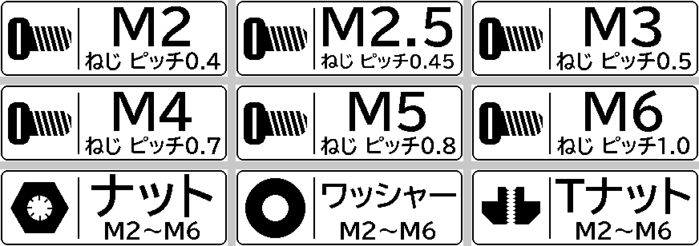

# 機械部品の袋ラベル



左にアイコン、右に大きくサイズ（または品名）、下に補足を入れた 14×40 mm の袋ラベルです。
1 つのテンプレート（`parts.p21.json`）を CSV（`parts.csv`）で差し替えて 9 枚まとめて出します。

```bash
p21 print examples/parts/parts.p21.json --csv examples/parts/parts.csv      # 9 枚
p21 print examples/parts/parts.p21.json --var icon=screw --var big=M8 --var "sub=ねじ ピッチ1.25"

# テンプレートに登録すると GUI の「マイテンプレート」からも使える（アイコンも一緒に保存される）
p21 template save 部品袋ラベル examples/parts/parts.p21.json
p21 print -T 部品袋ラベル --var icon=nut --var big=M8 --var sub=ナット
```

| 変数 | 内容 |
|---|---|
| `icon` | `screw` / `nut` / `washer` / `tnut`（`icons/` の PNG） |
| `big` | 大きく出す文字（`M3`、`ナット` など） |
| `sub` | 下の行（ピッチ、対応サイズなど） |

アイコンは `make_icons.py` で印字解像度（80×80 ドット）ちょうどに描いています。
